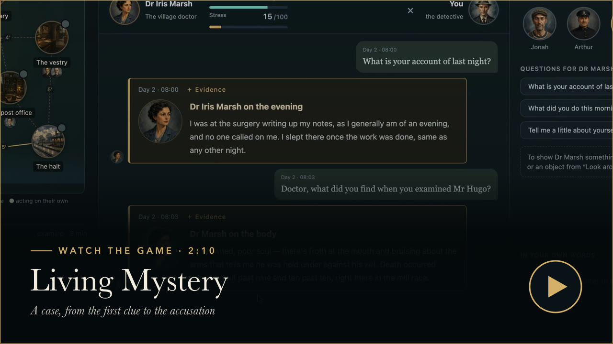
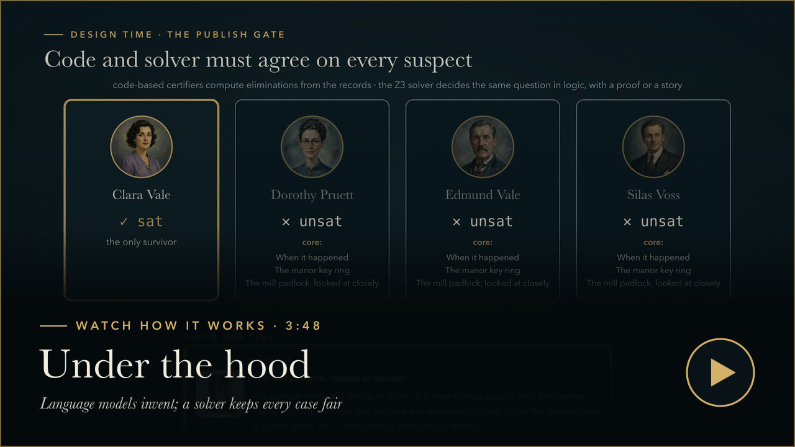

# Living Mystery

<p align="center">
  
</p>

A detective game in an English village in 1932, where every case is new, every character can be questioned in your
own words, and the village goes about its morning while you investigate. Language models write the cases, voice the
characters and decide what people do; a certifying engine makes sure that, whatever they produce, **the case stays
fair: there is always a way to the one true answer, and nothing anyone says breaks the true history.**

The research behind it is called **SleuthCraft**: certified living mysteries with solver-checked language models.

## See it in action

<table>
  <tr>
    <td width="50%"><a href="#watch-the-game"></a></td>
    <td width="50%"><a href="#watch-how-it-works"></a></td>
  </tr>
</table>

### Watch the game

A case from the first clue to the accusation: a village that moves while the clock runs, characters you question in
your own words, and evidence that changes what they say (2:10).

https://github.com/user-attachments/assets/3485d92b-dbfc-41f7-b8b3-eecb7f320d9f

### Watch how it works

How a case is written, certified and played: one true history, language models that propose, and code and a Z3 solver
that must agree on every suspect before a case is published (3:48).

https://github.com/user-attachments/assets/6b6e9098-227f-43f4-95a0-21d040ca66fb

## Quick start

You need Python 3.12 or later. Run everything from the repository root.

**1. Install (once).**

```sh
python3 -m venv .venv
.venv/bin/pip install -r server/requirements-solver.txt boto3
```

**2. Play without AI (no key or credentials).** Characters give their written answers from the menu of questions.

```sh
.venv/bin/python server/static_server.py      # then open http://127.0.0.1:8000
```

**3. Choose where the AI runs.** The AI characters and the living morning go through a local model proxy, which holds
your key or credentials; the browser never sees them, and the proxy sends a key only to its own provider and never
logs it. Keep keys out of the repository (export them in your shell, or `source` a file kept elsewhere). Use one of:

- **A Claude API key** (from the [Claude Console](https://console.anthropic.com)). It runs the models the game was
  tuned on, Claude Sonnet 4.5 and Claude Haiku 4.5:

  ```sh
  export ANTHROPIC_API_KEY=sk-ant-...
  LM_PROVIDER=anthropic .venv/bin/python server/llm_proxy.py
  ```

  Anthropic retires Sonnet 4.5 from its API on 30 November 2026. After that, add
  `LM_ANTHROPIC_MODEL=claude-sonnet-5-5` (not yet tested with the game).

- **An OpenAI API key** (from the [OpenAI platform](https://platform.openai.com)). The default model is `gpt-6-luna` with
  low reasoning effort; choose another with `LM_OPENAI_MODEL`:

  ```sh
  export OPENAI_API_KEY=sk-...
  LM_PROVIDER=openai .venv/bin/python server/llm_proxy.py
  ```

  Any OpenAI-compatible service works the same way with `OPENAI_BASE_URL` (for example
  `https://openrouter.ai/api/v1` and that service's key); a server on this machine (`http://127.0.0.1:<port>/v1`) needs
  no key. The game's prompts were tuned on Claude, so expect more replies to fall back to written lines on other models.

- **Amazon Bedrock** (AWS credentials). This is also what generating new cases needs. You need Bedrock in `us-west-2`
  with access to Claude Sonnet 4.5 and Claude Haiku 4.5 (request both under *Model access* in the Bedrock console), and
  `bedrock:InvokeModel` on those models and their `us.` cross-region inference profiles. Give the proxy credentials
  through a named profile (`aws configure --profile living-mystery` with access keys, or `aws configure sso --profile
  living-mystery` and then `aws sso login --profile living-mystery`) or the usual environment variables
  (`AWS_ACCESS_KEY_ID`, `AWS_SECRET_ACCESS_KEY`, and `AWS_SESSION_TOKEN` for temporary keys):

  ```sh
  aws sts get-caller-identity --profile living-mystery      # optional: check the credentials
  AWS_PROFILE=living-mystery AWS_REGION=us-west-2 .venv/bin/python server/llm_proxy.py
  ```

  Environment variables take precedence over `AWS_PROFILE`; if the proxy uses the wrong account, `unset` them.
  Temporary credentials usually expire within hours. For long sessions, use SSO or a profile with a self-renewing
  `credential_process`.

**4. Start the other servers**, each in its own terminal, next to the proxy from step 3 (port 8787):

```sh
.venv/bin/python server/static_server.py                                # the game     :8000
.venv/bin/python server/director_server.py                              # Z3 checks    :8788
AWS_PROFILE=living-mystery .venv/bin/python server/generator_server.py  # optional, Bedrock only: new cases :8789
```

`curl http://127.0.0.1:8787/health` shows the proxy's provider and models for each role.

**5. Turn on AI in the game.** Open http://127.0.0.1:8000, then **Menu → AI characters…**: keep the endpoint
`http://127.0.0.1:8787`, tick *Enable character reasoning and free-text conversation*, and save. Optionally, **Menu →
World Director… → Enable Z3 turn checks**. Choose a case under **Menu → Choose a case configuration…**: six are offered,
one easy, two medium and three hard.

**If the characters stop answering in their own words**, look at `logs/proxy.log`. On a Claude or OpenAI key it names
the problem and the setting to fix: *the API key was refused* (check the key), or *model … was not found* (choose
another model). On Bedrock, `ExpiredToken` means the credentials ran out (renew them and restart the proxy), and
`AccessDenied` means model access or IAM permission is missing, or the region is wrong. A proxy that will not start
says which setting is missing. Always open the game through the server at port 8000, never as a file.

## What is different

Most games that use language models let the model invent freely and hope it stays consistent. In a mystery that
fails quickly: a character contradicts an earlier answer, a clue points nowhere, or the case becomes unsolvable.
Living Mystery is built the other way round.

| Idea | What it means in play |
| --- | --- |
| **One true history** | Each case is a history of events, motives and clues. It is the only source of facts; everything shown to the player is checked against it. |
| **A model proposes, critics decide** | At every layer (writing the case, wording it, a character's reply, what the village does) a model proposes and a bank of critics decides: plain code for what can be checked mechanically, a second model for commonsense and wording, and a certifying kernel, cross-checked by the Z3 solver, for the case remaining solvable with a unique answer. |
| **Cases certified before you play** | A generated case is published only if it is solvable, its answer is unique, and it has real depth: lies and misdirection that the evidence later defeats. Difficulty is computed from the case's structure. |
| **Characters who speak freely, from what they know** | You can ask anyone anything. They answer in their own voice, but only from what they know; they lie only where the case says they lie, and a lie can always be broken by evidence. Asked plainly where they were last night, they answer with their account of it, true or a lie; with nothing to tell, they decline without adding a time, number or place. |
| **A living village that cannot trap you** | Each half hour a director plans what people do: they seek each other out, pass on what they heard, and a culprit may hide evidence, but only if the case can still be solved without it. |
| **A game that improves by playing itself** | Agent players with player profiles play the cases; their games are scored, judged and turned into experiments with registered predictions, and a bug track checks every recorded game against the true history. |

## How it works

```
 before play                                     during play
 ┌─────────┐  ┌────────────┐  ┌────────────┐     ┌──────────────┐  ┌───────────────┐  ┌───────────────────┐
 │ Premise │→ │ Generation │→ │ Publishing │  →  │ Conversation │  │ Living morning│  │ Accusation, hints │
 └────┬────┘  └─────┬──────┘  └─────┬──────┘     └──────┬───────┘  └───────┬───────┘  └─────────┬─────────┘
      │ a model proposes; code, a second model and the certifying kernel (with Z3) decide, at every layer │
      └──────────────────────────────┴─────────────── one true history ───────────────┴─────────────────┘
```

Generation and publishing run their model calls in parallel and check every result as it lands. At each layer of
a case three drafts aim at different threads; code and a critic check each, a rejected draft is revised in the same
round, and passing drafts for different threads are applied together. Publishing writes the case's words in parallel
waves, has focused judges check each kind of line, and ends with a panel of narrow reviewers and a scripted player
that must solve the case by following its hints. A medium case takes about 11 minutes to generate and 7 to publish
([generation and publishing](docs/generation-and-publishing.md)).

The [living technical report](dist/report/index.html) explains each layer; [docs/architecture.md](docs/architecture.md)
gives the engine contracts.

## Playing, and the local servers

The game server alone is enough for scripted play with the original case, *The Last Bell*, and the six generated cases
in the menu (retired cases are kept in `dist/cases/archive/`); it makes no model requests. The model proxy adds AI
characters and the living morning (on Bedrock, the Claude API, the OpenAI API or a compatible one, or a local model),
the director server adds Z3 checks, and the generator server adds new cases, which take about 15 to 35 minutes each and
always use Bedrock (setup is in the [quick start](#quick-start)). `LM_PROVIDER` sets where every role goes; `LM_ROUTES` sends
single roles elsewhere, for example `LM_ROUTES="checker=anthropic:claude-sonnet-4-5-20250929"`. The proxy's module
docstring and `server/llm_backends.py` list every setting.

**These servers are for this machine only.** Each binds to 127.0.0.1 and answers only requests whose `Host` is its own
(`127.0.0.1:<port>` or `localhost:<port>`), so a page on another name that resolves to 127.0.0.1 (DNS rebinding) is
refused. The proxy, director and generator also require an `Origin` from `LM_ALLOWED_ORIGINS` (explicit local
`http://host:port` origins, parsed once in `server/local_origins.py`; the default is the game's own two) and their own
`X-Living-Mystery` header. The game server never serves dotfiles. A client that stalls mid-request is dropped after 30 s
without socket activity; a slow model call is not cut off. These checks keep other web pages out; they are not
authentication against other programs on the machine, so never expose the servers beyond loopback. With
`LM_AUDIT_FILE=<path>` the proxy keeps a JSON-lines ledger of its model calls (metadata and hashes, never prompt or
reply text, and no error messages); a failure to write it never costs a reply. The proxy's module docstring lists its
request contract and every setting it reads.

**A local open-weight model instead of Bedrock.** Each in-game call has a role (`character`, `checker`, `director`,
`line_critic`, `autonomy`, `dialogue`), and the proxy sends each role to the backend and model in `LM_ROUTES`; roles not
named stay on Bedrock. For example, with [Ollama](https://ollama.com) and Gemma 4 for the characters and their
fact-checker:

```sh
ollama serve &  ollama pull gemma4:26b
LM_ROUTES="character=ollama:gemma4:26b,checker=ollama:gemma4:26b" .venv/bin/python server/llm_proxy.py
```

The proxy prints its routes on start and reports them at `GET /health`, with the turn timeout the game should use
(240 s when the character or checker is local, 45 s on Bedrock). Stop it and start it without `LM_ROUTES` to go back.
`OLLAMA_URL` (a loopback root URL, default `http://127.0.0.1:11434`) is read and checked only when a route uses Ollama.
Case generation and the playtest tools always use Bedrock.

In the game: choose a case from the menu, or **✨ Generate a new deep case**. Talk to people with the listed questions
or in your own words, examine what you find, show it to people, and take your case to the constable. The constable is
on your side: he briefs you (in medium and hard cases he sends you only to the doctor), never lies and holds nothing
back. The menu never offers two questions that ask the same thing. Someone caught in a lie owns up and says why;
someone behaving oddly turns your first question aside, but pressed again gives the reason. What a person keeps (the
doctor's notes, the dead man's effects) they hand over when you have earned it, and shown a clue that needs one of
their own findings they compare the two for you. The notebook's **Hints**
tab gives one nudge at a time; a hint about what someone knows names the question that actually draws it out. When the
constable accepts your case, the closing file tells you what you missed: why each innocent person lied, and what each
odd behaviour you did not get to the bottom of really was. **Menu → 🐞 Flag an issue** saves a note and the game state
to `logs/game.log`.

## Improving the game by playing it

`tools/playtest/` runs the game through a text interface for agent players (beginner, amateur and pro profiles) and
treats every change as an experiment: a cause checked in the data, a prediction written down first, a cheap offline
check, then paired games on held-out cases. A separate bug track checks every recorded game with invariant detectors
and a correctness judge, and each finding is reproduced and confirmed before it counts.

What it has found so far ([details](docs/self-improvement.md)):

- **Hints** that name whom to see and the question to ask: hints that lead to their clue rose from 57% to 87%.
- **Six general bugs**, found from the agents' own games and fixed, from hints that quoted the wrong question to
  sightings that broke an alibi without the case counting it.
- **Dead ends**: on the same recorded questions, turns that leave the player with nothing fell from 28% to 7%.
- **Changes it rejected**: two changes that looked like improvements made the game worse in paired play.

```sh
.venv/bin/python tools/playtest/run.py --batch e0-heldout --split heldout --parallel 9    # play
.venv/bin/python tools/playtest/score.py tools/playtest/runs/e0-heldout                   # scorecard
.venv/bin/python tools/playtest/judge.py tools/playtest/runs/e0-heldout                   # judged experience
.venv/bin/python tools/playtest/report.py tools/playtest/runs/e1-heldout --baseline tools/playtest/runs/e0-heldout \
    --comparison-registration registration.json                                          # audited paired comparison
node tools/playtest/bugs.mjs --out bugs.json tools/playtest/runs/e*/                      # bug detectors
.venv/bin/python tools/playtest/correctness.py tools/playtest/runs/e0-heldout             # correctness judge
```

A paired comparison is registered before any model call: a JSON file naming Arm A and Arm B, the episodes and the
budget. Both arms run with `--comparison-registration registration.json`: Arm A with `--registered-arm A`, planned
independently, and Arm B with `--registered-arm B --plan-from <arm A>`. `report.py --baseline` reports the pair only
when the offline audit passes; `--legacy-descriptive` describes historical batches that fail it, labelled as
ineligible for the gate.

Each batch directory holds hash-only provenance (`provenance.json`) and an audit of the harness's own Bedrock calls
(`direct_requests.jsonl`; the judge appends to the same file). The characters speak through the proxy at `LM_PROXY_URL`
(default `http://127.0.0.1:8787/`). The harness does not write the proxy's audit: to keep one, start the proxy with
`LM_AUDIT_FILE=tools/playtest/runs/<batch>/proxy_requests.jsonl`. Provenance records that file as an operator-supplied
artifact and whether it was present when the batch finished, and every batch ends with a terminal status
(`completed`, `aborted`, `early_stopped` or `failed`).

## Documentation

- [Technical report](dist/report/index.html) (edition 0.28; [continuous edition](dist/report/complete.html)): the
  connected argument, with diagrams; sources in [docs/report/](docs/report/index.md).
- [Claims](docs/claims.md): the language of clues (eleven predicates over facts that change with events), how a claim's
  truth is computed in the history, and why reasoning from what the player knows is sound and complete.
- [A worked example](dist/report/worked-example.html) ([source](docs/report/worked-example.md)): one case's records, and how the kernel, Z3 and the model critics reason over them, at design time and at run time.
- [Self-improvement by playtesting](docs/self-improvement.md): the method, the tools and every result.
- [The living village](docs/living-village.md): sightings, the morning director and the rules found by playing.
- [Mystery kernel](docs/mystery-kernel.md): the history's four record types, certification and refinement.
- [Generating and publishing a case](docs/generation-and-publishing.md): the parallel generation loop, publishing's
  writers, judges and review panel, the gates, and the timing tools for seeing where a run spends its time.
- [Character turns](docs/character-turns.md): how a free-text reply is proposed, checked and committed.
- [Architecture](docs/architecture.md) and [roadmap](docs/roadmap.md).
- [AGENTS.md](AGENTS.md): where things are and how to test them, for anyone (or any agent) changing the code.

## Code map

| Where | What |
| --- | --- |
| `dist/kernel.mjs`, `dist/engine.mjs`, `dist/engine-runtime.mjs` | Event log, replay, saves and action routing |
| `dist/mk/kernel.mjs`, `dist/mk/claims.mjs`, `server/case_oracle.py` | The certifying kernel (reachability, depth, certification), the claim semantics it uses (truth in the history, elimination from what the player knows), and the Z3 reference it must agree with |
| `tools/refine-c/claims.py`, `tools/refine-c/migrate.py` | The Python twin of the claim semantics, and the migration of older cases to the current claims version |
| `dist/cases/kernel-case.mjs`, `dist/cases/village.mjs`, `dist/cases/questions.mjs` | A generated case in play (accounts, evidence, hints, the constable), the village setting, and the standard questions with the alias rules shared by play and publishing |
| `dist/character-turn.mjs` | Free-text conversation: the character's perspective, which accounts a question needs, code checks, the fact-checker and fallbacks |
| `dist/morning.mjs`, `dist/morning-director.mjs` | The living morning and its director with code, model and kernel critics |
| `dist/ui.mjs`, `dist/styles.css` | The browser interface |
| `tools/refine-c/` | Case generation (`premise.py`, `refine.py`) and publishing (`publish.py`, `enrich.py`; `publication_io.py` for crash-safe writes and the shared publication lock); `timing.py` and `status.py` for where a run spends its time; `regenerate.py` and `repair_live.py` |
| `tools/playtest/` | Agent playtesting, scoring, judging, experiments and the bug track; `scripted.mjs` and `gate.mjs`, the scripted players publishing must pass |

## Tests and limits

The tests need Node 20 or later, and `pytest` in the environment (`.venv/bin/pip install pytest`).

```sh
npm test                                                   # 379 JavaScript tests
.venv/bin/python -m pytest tests/ -q                       # Python tests: servers, solver, oracle, playtest tools
(cd tools/refine-c && ../../.venv/bin/python -m pytest -q)  # generation and publishing tests
(cd tools/refine-c && ../../.venv/bin/python parity.py)     # the Python and JS kernels agree on 443 cases
npm run docs:check
```

The guarantees are about the records: solvability, a unique answer, depth, and that what characters say agrees with
the history as far as the critics can tell. The fact-checker is a model, so a reply can still slip through; hints and
difficulty are measured on agent players, not yet calibrated against people. Generating and publishing a case takes
about 20 minutes for a medium case and 35 for a hard one.
The local client, its saves and the inspector expose the hidden truth; the servers are for local use only.

Publishing is crash-safe: a case is written and read back before the index lists it, under one lock shared by every
tool that writes published cases (generator, `publish.py`, `backfill.py`, difficulty re-rating). An interrupted
publication is finished by the next run; a recovery marker that cannot be trusted is set aside
(`.publication-transaction.rejected-*.json` in `dist/cases/generated/live/`) with a warning, and the case it names
stays unlisted.

## License

MIT. See [LICENSE](LICENSE).
