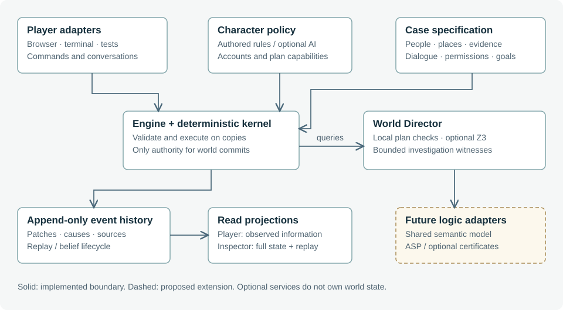

# 2. System architecture and authority boundaries

**Status: implemented architecture with experimental AI and Director paths.**



## 2.1 Three implementation layers

The kernel, case and engine façade divide mechanics from content. `dist/kernel.mjs` supplies event commits, replay, travel, minute-by-minute time advancement, perception and persistence checks. `createKernel(model)` binds those mechanisms to case tables. The kernel's decision policy is injected by the engine rather than imported from a particular mystery.

`dist/cases/last-bell.mjs` supplies the world factory, initial beliefs, routines, scored decision candidates, authored dialogue, evidence reactions and accusation rubric. Its data tables live in `dist/case.mjs`; structured claim definitions and reasoning-board metadata are separate modules. `dist/engine-runtime.mjs` assembles a case-bound kernel and command API. `dist/engine.mjs` selects the runtime by session case ID and applies admission at public dispatch boundaries. `dist/cases/bellweather.mjs` builds authored and generated variants from explicit specifications; `dist/prehistory.mjs` executes their evening history. Each case is further composed from **narrative modules** (`dist/modules/`): reusable bricks that add clues, sourced prehistory, capabilities and dialogue and declare a local invariant, and `dist/casegen.mjs` validates a composed specification (and can sample new ones) before it is playable — see [Composable narrative modules and validated sampling](generation.md#10-8-composable-narrative-modules-and-validated-sampling).

This separation is a useful generation target, not proof of complete case independence. The variants share Last Bell entity IDs and graph, with a finite configured forensic domain; legacy exports and some presentation assumptions still refer to that cast. A procedural case must eventually replace those assumptions with declared capabilities or explicit case adapters. Merely swapping a data table would not yet produce a complete new game.

## 2.2 State as a fold of events

Let W₀ be the case's initial world and Δᵢ the patches on event eᵢ. State at an event prefix is defined operationally by:

```text
Wᵢ₊₁ = apply(Wᵢ, Δᵢ)
Wₙ   = fold(apply, W₀, [Δ₀, …, Δₙ₋₁])
```

An event includes an ID, index, simulation minute, actor, location, kind, causal parent IDs, structured data, before/after patches and optional player-visible text. Parents express recorded causal links; chronological adjacency alone is not a causal explanation. Events at the same minute retain a total order through their indices. The implementation does not claim that a parent list is a complete causal model of every effect.

A player command establishes a root event. Dialogue, movement, observations and NPC decisions create descendants, followed by a completion checkpoint. `worldAt` reconstructs a prefix from the base world. It does not run the scheduler, regenerate dialogue, or change the live session. Import validates the event/patch history against the saved world. Selected legacy repairs, such as a completed correction intention, append repair events rather than silently modifying earlier events.

A generated (kernel) case travels inside its saves, and its runtime is bound to the exact records a save carries, identified canonically (keys sorted, undefined members dropped, so a record and its JSON round trip share one identity). `dist/engine.mjs` validates a save by full replay before it adopts or caches the embedded case, so a rejected save leaves no definition and no cache entry behind. Cases bound only by saves are cached least-recently-used, sixteen at a time; a live session keeps its own runtime regardless.

## 2.3 Nested transactional boundaries

The AI character pipeline prepares a ticket containing the serialized starting session and a restricted context. An accepted proposal runs on a candidate copy; diagnostics must pass before that candidate replaces the live state. If the session changed while the model was working, the ticket is stale and cannot authorize the turn.

When World Director is enabled, the UI stages the whole candidate turn on a copy. The Director inspects newly recorded, locally admitted plans, checks their queries, and optionally searches for an investigation witness. Only a successful result commits the candidate's world and events. Cancellation leaves candidate effects unapplied. A rejected or unresolved Director check may append a private decision audit to the original session while leaving the attempted action's time and effects uncommitted.

Configured life deliberation uses its own perspective-limited, stale-checked ticket. The UI stages optional life choices with the player action or accepted conversation, so cancelling the pending turn leaves both effects unapplied. This outer copy exists even when optional Z3 is off. Configured public dispatch additionally requires local investigation admission, while the raw runtime is reserved for internal replay witnesses.

Consequently, a displayed “checking” indicator belongs to pending validation, not post hoc approval of a response already made authoritative. The UI now shows it only when a real symbolic check begins. [Character turns](characters.md) details generation and criticism; [Director](director.md) details the outer boundary.

## 2.4 Runtime and deployment boundary

The browser loads ES modules and retains the local investigation. A Python proxy serves optional model requests; a separate Python service exposes Z3 on loopback port 8788. The solver service has no need to call an LLM. Every local server binds to 127.0.0.1 and answers only its own `Host` (`127.0.0.1:<port>` or `localhost:<port>`), which defeats DNS rebinding; the proxy, solver and generator also require an exact origin from one shared parser of `LM_ALLOWED_ORIGINS` (`server/local_origins.py`) and a custom request header, and the game server never serves dotfiles. Socket reads and writes time out after 30 s, so a client that stalls mid-request cannot hold a thread, while a model call in progress is bounded only by its backend's own timeout. The proxy's optional request ledger (`LM_AUDIT_FILE`) keeps metadata and hashes, never prompt, reply or error text, and a failure to write it never affects the reply. These checks restrict browser pages; they are not a production authentication system against other programs on the machine.

The public player projection and omniscient inspector are presentation boundaries within a local single-player application. Source files and exported saves contain secrets. Preventing a technically curious player from reading the solution is outside the current security model. A future hosted multiplayer or adversarial setting would need a different server-authority and access-control design.

## 2.5 Scaling implications

Full reconstruction from W₀ is simple and auditable, but repeatedly scanning a growing event history will not scale indefinitely. Proposed improvements include periodic snapshots, indexed event lookup and causality queries, and bounded perspective retrieval. Each optimization must preserve prefix semantics: an index must not accidentally return a later observation while inspecting an earlier world. This is a correctness requirement before it is a performance feature.


## 2.6 Proposed admission boundary

The refined target adds an explicit pre-deliberation filtering boundary before
scripted or AI choice, followed by a latest-state execution boundary. Certificates
or constrained capabilities carry semantic dependencies, assumptions, horizon and
rule/adapter versions; they are invalidated by relevant state or time changes.
All admitted transitions must preserve hard invariants, using direct checks,
applicable symbolic queries or a sound preservation argument. This extends the
current selected-plan transaction rather than claiming it already covers the
whole simulation. See [Figure 8](director.md#6-7-two-stage-admission-for-autonomous-agents).

## 2.7 Configuration-specific admission

New configurations stage every public player or character action on a copy and require a replayed acquisition witness before committing it. Relevant intermediate access/possession and declared expiry changes receive separate prefix checks. A terminal flag cannot bypass an earlier failed check. This local boundary is active independently of the optional solver; Z3 can additionally verify represented short plans. Original saves retain the original optional Director boundary.

`investigation.mjs` constructs candidate acquisition routes; `admission.mjs` governs their use in transition and capability checks. Engine-internal witness execution uses the raw case runtime to avoid recursive admission. This is trusted developer machinery, not a security interface. See [the Director chapter](director.md) for model bounds and unresolved semantics.

## 2.8 One model, distinct guarantees

| Boundary | Implemented decision | What it does not establish |
| --- | --- | --- |
| Case sampling | Typed sources, physical history, finite discrimination and replay of each route | Arbitrary new worlds or universal future solvability |
| Knowledge update | Registered support rule for configured observations, testimony and inferences | Truth of all speech or automatic interpretation of prose |
| Agent plan | Local preconditions, commitments and supported temporal constraints; optional Z3 | Complete prediction of every other agent's future |
| Player accusation | Alternative suspect/method/motive combinations consistent with selected acquired records | Exclusion of unmodeled accomplices, weapons or forged records |

The browser evaluator and Z3 consume the shared finite IR. Solver output is a validation result, not permission to patch history or silently teach characters hidden facts. The proposed multi-logic inference-feedback architecture remains a separate extension.
