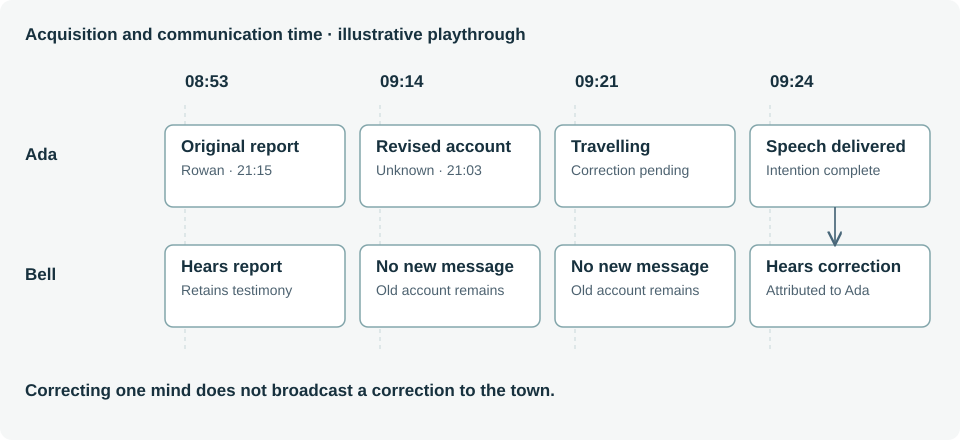

# 7. Worked examples from The Last Bell

**Status: implemented reference scenarios. Spoilers throughout.**

## 7.1 The authored case

Edmund Vale is found dead in his study. Silas Voss, the estate solicitor, is the authored culprit; the case connects diverted payments, a brass seal and a constrained crime-night timeline. Clara Vale protects a private relationship with Rowan Pike. Ada Finch has an uncertain visual observation and an unreliable clock reference. Dr Iris Marsh and Constable Arthur Bell provide medical and investigative anchors.

The case deliberately separates lying from murder. A false alibi can protect an unrelated secret. A confident witness can be honestly wrong. The player's task is to test attribution, timing and physical evidence rather than reward confidence or punish every contradiction as guilt. The current accusation rubric still checks authored evidence bundles; [generation](generation.md) explains how future alternative-explanation checks should strengthen it.

## 7.2 Ada's correction as information flow

Ada initially reports what she interprets as Rowan's green coat at 21:15. The inn clock is twelve minutes fast, so that reading corresponds to 21:03. Recognizing clothing does not establish the wearer's identity. Showing Ada the clock evidence revises both the time and the strength of identification.

One observed playthrough contained the following sequence. These timestamps are an example trace, not schedule constants or a performance result.

| Morning time | Recorded development | Knowledge consequence |
| --- | --- | --- |
| 08:53 | Ada gives Bell her original account | Bell can retain the mistaken testimony. |
| 09:14 | Detective presents the fast-clock evidence to Ada | Ada revises her sighting; Bell does not update remotely. |
| 09:18 | Ada expresses her intention to correct Bell | A stated intention still does not constitute delivery. |
| 09:21 | Ada leaves for the square | Travel begins; correction remains pending. |
| 09:24 | Ada actually speaks to Bell | Bell receives attributed revised testimony. |
| 09:30 | Ada is returning toward the inn | The pending correction is retired and completion is recorded. |

The corrected sighting explicitly depends on Ada's visual observation and her knowledge of the clock evidence. A pending correction depends on the revised account. On actual delivery, a generic intention-completion operation retires the pending belief and records a completed belief sourced to the speech event. Bell's text attributes the correction to Ada instead of presenting her first-person speech as his own memory.

This sequence exercises multiple distinctions: physical travel versus intention, speaker revision versus recipient knowledge, historical truth labels versus testimony confidence, and current beliefs versus earlier snapshots. The model is useful precisely because these states can disagree temporarily without making the world inconsistent.

## 7.3 Silas's concealment as a consequential plan

Learning that the detective knows the accounts can raise Silas's priority for concealing the forged folio. The authored plan retrieves the document at the manor and stores it in the vestry drawer, adding travel steps when required. A valid plan needs physical access before taking and possession before storage. An AI-selected case-granted concealment uses shared transfers and preserves relevant narrative callbacks.

A local witness can observe the retrieval. That observation can support Clara's later report, subject to her cooperation. A remote character does not learn either the action or Silas's motive from a successful private solver check. Seeing the retrieval does not reveal the final hiding place; another observation would be needed for that claim.

After a selected concealment turn, the optional Director searches acquisition actions for a surviving investigation. The physical evidence route can succeed even when the folio moves. This result establishes a replayable route in that state; it does not show that every clue or conversation remains available.

## 7.4 Bell's survey as an AI-plan probe

At the square, a player can ask Bell to look around the inn after the conversation. The model may select `survey:inn`, refuse, or continue discussing the question. If an accepted proposal contains that capability, the queue records it. Bell remains engaged until release, then travels and observes his actual surroundings on arrival.

Saving during travel and reloading tests whether the plan exists as engine state rather than an ephemeral promise in the model's context. The resumed plan should not need another model request. If a plan instead communicates an observation and that source is revised before delivery, it becomes blocked rather than relaying a stale account. These are controlled probes of the architecture, not claims that the character now has general autonomous investigative competence.

## 7.5 Three same-cast reference configurations

The new browser case menu offers three fixed variants alongside the original. The following table is omniscient author/debugger material.

| Configuration | Culprit | Means | Motive | Fatal event |
| --- | --- | --- | --- | --- |
| The Ledger | Silas | Brass seal | Conceal diverted estate payments | 21:14 |
| The Codicil | Clara | Silver candlestick | Prevent an inheritance change | 21:34 |
| The Notice | Rowan | Pruning knife | Prevent family eviction | 21:54 |

The two innocent suspects attend a greenhouse appointment witnessed by Dr Marsh across the fatal interval. A timed signature places the remaining suspect at the manor; the damaged object, floor trace, medical examination and estate decision support the configured physical case. This is a deliberately explicit evidence rubric, not a general solver-derived argument. The variants do not yet reproduce the original affair, rumor-correction and folio-concealment storylines.

To test, leave AI off, choose a configuration, ask Bell for guidance and investigate the six evidence categories he identifies. Inspect the pre-morning trace to review travel, the crime and the doctor's report. Follow acquired evidence back to its source. Restart preserves the configuration; export/import resumes its own history. The original Bell survey example above applies to the original case: the new configurations reserve Bell at the square to enforce their investigation assumption.
