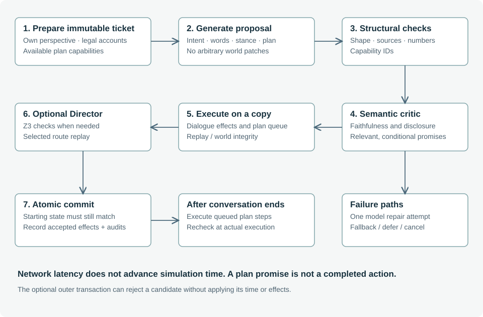
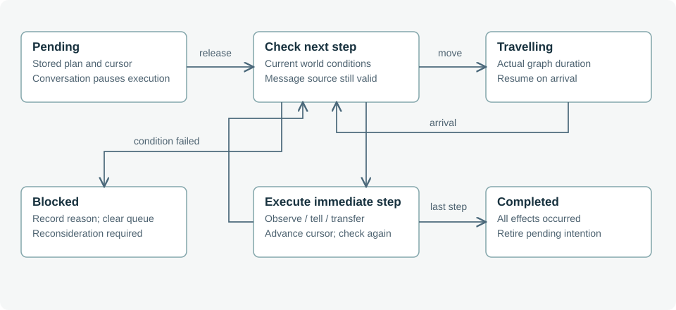
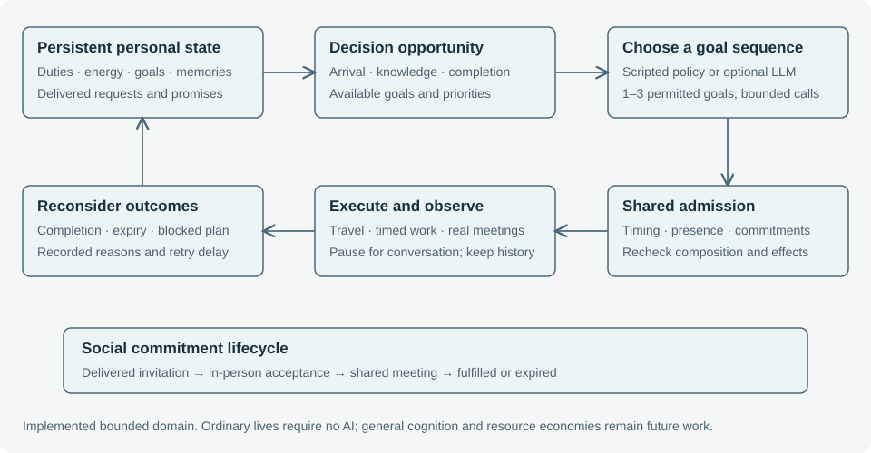

# 4. Character policy, dialogue and physical plans

**Status: deterministic play implemented; optional AI turns and capability plans experimental.**

## 4.1 Two policies, one authoritative world

Scripted mode selects authored responses through case rules and supported topics. Autonomous decisions compare scored candidates such as maintaining a routine, protecting a relationship, correcting testimony or concealing evidence. Beliefs, flags, trust and location gate those candidates. This is a combination of stateful rules and scored policies, not a single explicit dialogue finite-state-machine implementation.

AI mode adds interpretation and expressive choice. A character selects an available account, communicative intent, natural wording, bounded trust/belief stance, engagement choice and optional physical-plan capability. The engine still owns all consequences. There are no autonomous background model calls on every simulation tick; queued plans execute deterministically after selection.

## 4.2 Perspective-limited preparation

A ticket supplies the character's own beliefs without truth labels, personality, values, goals, relationships, mood, recent memories and direct conversation history. Current limits include 18 retained memories and 12 recent direct speech entries in the prompt; the underlying character memory list retains up to 80 references. These are bounded windows, not semantic retrieval or unrestricted long-term reasoning.

Available accounts are generated by previewing supported case actions on isolated copies. Each account has an ID, authored statement, claim keys, source events, deception label and selected consequences. An explicit dialogue button offers its corresponding account; free text offers a broader supported topic set. Private beliefs can motivate a response but are not automatically licensed disclosures.



## 4.3 Validation and natural language

Structural validation checks the proposal shape, choices, account availability, claim/source equality, text bounds and numeric anchors. The separate-context critic checks semantic fidelity, relevance, continuity, unsupported disclosures, invented actions and consistency of belief or engagement choices. A permitted deceptive account remains permitted deception. The critic is not asked to force every character to tell the truth.

A passing critic verdict must parse strictly and have no violations: the critic is instructed to emit a single JSON object with no surrounding prose or code fence, so a verdict followed by explanatory commentary is treated as ambiguous and refused rather than parsed. Up to three generation attempts permit two repairs using the validation or fact-checker feedback. When the fact-checker has rejected an earlier reply, the third attempt is guarded: the character keeps untold memories private and deflects in character, unless the question requires an account of last night. Generation and critic use the same Bedrock model by default (`LM_CHARACTER_MODEL`; `LM_ROUTES` can route them apart), so their errors may be correlated. The request orchestration and response matching prevent several classes of accidental misuse; they do not prove that a faithful natural-language paraphrase was produced.

The AI budget is at most three generation and three critic requests within one client deadline (the turn timeout the proxy advertises: 45 seconds by default, 240 seconds when the character or checker runs on a local model). When every attempt is rejected, a menu question gives its published account and a free question falls back as described in [4.8](#4-8-free-text-questions-hints-and-the-notebook-in-generated-cases); rejected wording is never committed. The generation prompt also directs a character to decline cleanly — a brief in-character "I could not say," with no account selected — for any question outside its perspective and knowledge, so an out-of-scope question yields a graceful passing non-answer instead of speculation the critic must reject; this is the general mechanism, not per-character scripted refusals. Cancellation applies no response. These controls bound orchestration; empirical quality, provider latency and monetary cost still require measurement.

Edition 0.11 improved naturalness within these bounds. Each cast member now carries a `pronoun`, a proper `address` (Mr Pike, Miss Vale, Dr Marsh, Constable Bell, Mrs Finch) and a `voice` (register), and the perspective ships a roster of everyone's name/address/pronoun; the prompt instructs the model to speak in that voice, briefly, and never to invent a title or gender (fixing "Miss Rowan" for a man and an over-formal constable). Two mechanisms had been quietly forcing the stiff authored fallback: the deterministic number gate required the reply to contain the exact digit-figures of the account, which rejected a faithful period rephrase like "21:30 → half past nine" — it now blocks only *invented* figures, leaving semantic time fidelity to the critic; and the present handler previously gave every non-witness the generic "I can only speak to what I witnessed", so a neutral examiner would not confirm what a lab report plainly states — a non-culprit shown an objective record (observation, document or physical trace) now confirms its content, while the culprit still deflects what implicates them. The character generation runs at a warmer temperature and the prompt forbids reciting a record word-for-word. A short live check found the critic itself is not the bottleneck: most turns pass on the first attempt with natural, in-voice replies; the remaining fallbacks were the number gate and the missing record-confirmation account, both addressed here.

## 4.4 Bounded physical-plan capabilities

Proposal version 2 adds `plan`, a capability ID or null. The trusted catalog currently offers surveys of public locations, transfers of held objects to local recipients, sharing selected witnessed location observations, and case-granted concealment. Silas's concealment capability requires his relevant knowledge of the detective's interest in the accounts. Narrative modules contribute case capabilities through the same catalog: a **fetch**-shaped concealment lets a culprit retrieve a document whose location it legitimately knows (gated on its own belief, not a leaked fact) and hide it, and an **inform**-shaped plan lets a witness travel to a recipient and communicate a belief it holds — used by the honest-mistake correction, which now delivers to Bell in person rather than only revising a local belief. Models cannot invent an object identifier, container, action verb or arbitrary patch.

```json
{
  "id": "survey:inn",
  "actor": "bell",
  "label": "Look around The Rook & Lantern",
  "sources": [],
  "steps": [
    {"kind": "move", "to": "inn"},
    {"kind": "observe", "location": "inn"}
  ]
}
```

This example assumes Bell starts elsewhere. Capability generation adapts the steps to his actual starting state. Plan admission checks the current capability again before queueing it. It is bounded multi-step selection, not unrestricted plan synthesis.

## 4.5 Engagement and execution

Conversation engagement pauses the addressed character's autonomous activity. Other characters continue when game time advances. After conversation release, a queued plan executes against the shared contracts: travel begins, the cursor advances, and remaining steps resume at arrival or a later decision opportunity. Transfer, communication and observation are currently instantaneous actions at a simulation minute; travel uses graph-derived duration.



Every step is rechecked. An absent recipient, changed possession, inaccessible container or revised message source can block the plan. Successful transfers create local perceptions and case-specific consequences. Save/load preserves the queue, so continuation does not need a new model call. A future planner should be allowed to revise a blocked intention, but that revision must itself pass admission and preserve the record of the failed attempt.


## 4.6 Proposed hybrid deliberation

The next step broadens event-triggered deliberation while retaining authored
candidates and commitments. The Director constructs a dynamically admissible
choice set before the character reasons, using inexpensive local checks and
symbolic filtering where constraints interact. An agent ranks those choices for
its own goals, then submits a concrete proposal for composition and execution-time
checks. The menu is a sound bounded subset, not necessarily every possible plan.
This broader filtering stage is proposed; today's catalog does not establish
continued solvability for every offered choice. The
[two-stage admission design](director.md#6-7-two-stage-admission-for-autonomous-agents)
also addresses hidden-information leakage through capabilities and rejection
feedback.


## 4.7 Autonomous daily lives



Configured and generated cases now give each NPC public responsibilities and personal interests independent of the culprit assignment. Life state records energy, goals, task completions, active timed work, retry state and model cooldown. Work, errands and rest consume simulated time. Current work pauses for player conversation; other characters continue. Arrival, knowledge changes, completion and periodic checkpoints provide reconsideration opportunities. Mystery modules take priority when choosing a new plan, while an active plan normally runs until completion or failure.

Invitations are delivered by actual co-located speech. The recipient can accept or decline; acceptance also happens in person and records a shared meeting window. The requester waits for a bounded response interval. Future partner locations come from local perception, retained sightings or public-workplace expectations, so a trip can fail. Both participants must attend before fulfillment. Expiry and capped retry delays preserve unsuccessful encounters instead of rewriting them into successes.

Policy ranks currently permissible choices by responsibility, elapsed time, fatigue and social obligations. Accepted appointments constrain plans before utility selection. The shared action IR now includes a timed activity with presence, duration, deadline and frame constraints. The executor checks that the task is licensed for this NPC. A composed sequence must still fit accepted commitments; individually safe choices are not assumed safe together.

Optional model deliberation receives one NPC's goals, beliefs, memories and known commitments and chooses one to three current goal IDs. Social choices stand alone until their outcomes are known. Only the trusted engine expands IDs into actions; no generated prose or patches become world facts. Each player turn can add one five-second request, with a twenty-simulated-minute cooldown per actor and oldest-opportunity rotation. Malformed or unavailable responses fall back to scripted selection. Stale responses and cancellation cannot commit the pending player turn.

These are bounded ordinary lives, not a complete production economy or general cognition. Errands have timed completion records rather than inventories and money. The original case retains its legacy behavior. Tests establish orchestration and finite-domain behavior; real-model decision quality, richer relationship consequences and contingent investigative robustness require further evaluation.

## 4.8 Free-text questions, hints and the notebook in generated cases

**Status: implemented for generated (kernel) cases.**

**Which account a question needs.** A plain "Where were you last night?" must be answered with an account of last night, a lie or the truth. Code recognises the question with the same plain-whereabouts rule the menu uses (`isPlainNightQuestion` in `dist/cases/questions.mjs`), lists the night accounts as `player.requiredAccounts`, and validation rejects any other choice. All other routing is advisory (`player.relevantAccounts`): the account the person has just given, when the question follows it up at once ("And when was that?"), and otherwise the accounts sharing the most specific words with the question. The model is told to prefer them; validation does not enforce them.

**What an account may add.** Each account carries `claimDetails`: exactly the time window and place of its own typed claim. Certification already holds the account to that claim, truth or lie, so saying it adds nothing the certificate does not cover. An account without a timed claim carries no details, so an evening summary is spoken in its own words only. Nothing is taken from the history at play time.

**Replies with no account.** Code screens them first: no clock time, number or place the detective has not already mentioned. The name guard checks the people named in every reply. Clarifying questions, challenges and reactions keep their own words, and the fact-checker judges everything else. The fact-checker sees the selected account and the character's true accounts (`ownAccounts`), so it can catch a contradiction of what the character can truthfully say, and it rejects a reply that leaves unanswered a part of the question the selected account or its `claimDetails` covers.

**When every attempt is rejected.** A menu question gives its published account. A plain night question gives the published night account the model chose, if that attempt passed every code check. Any other free question declines in the person's published, fact-free words. Rejected wording is never committed.

**Questions in play.** Menus, hints and done markers share one question identity: a published alias (`same_as`, see [10.17](generation.md#10-17-the-history-is-the-only-source-of-facts)) resolved along the speaker's own accounts to a question that delivers it, together with the plain-whereabouts rule, which play applies to cases published earlier as well. An alias that would not deliver its account is ignored and the account keeps its own button. Menus therefore never show two questions asking the same thing, and asking an equivalent question counts as the same action.

**Hints that name a question.** The second level of a testimony hint names the action that actually leads to the account. The bridge finds it by trying it on a copy of the game with the player beside the speaker: one listed question, two in a row, or the same question repeated, in which case the hint says to ask it "more than once: they tell it a piece at a time"; failing that, something the player holds that draws the account when shown. When nothing leads there from the current state, the hint says to talk to the person again in their own words. It never quotes a question the player has already finished.

**What the notebook keeps.** For generated cases the notebook records the published account, which is what certification holds the account to; the character's spoken words stay in the conversation. Spoken testimony is remembered by the speaker only. Bystanders remember the physical discoveries they witness, so they cannot later deny them.
