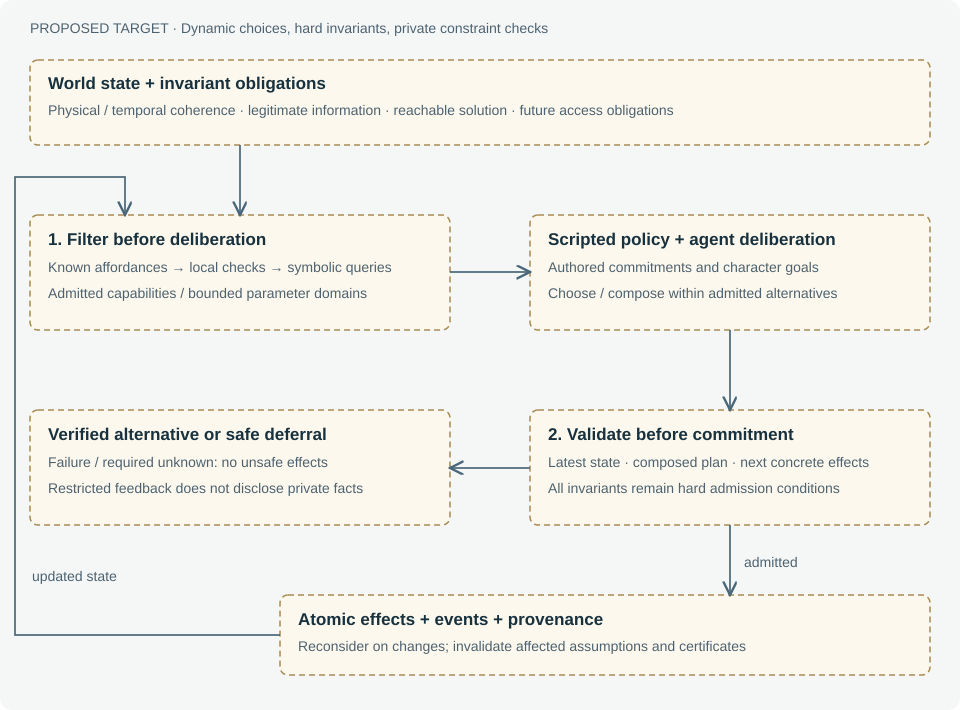

# 6. World Director and investigation viability

**Status: experimental bounded admission and witness search; general viability and recovery are proposed.**

## 6.1 The coordinator's role

World Director is the term used for the global coordination layer. It belongs within runtime agent-output validation, the second of the three symbolic use cases. The other two are future case creation and evaluation of the player's final argument. The Director is not an omniscient character who whispers private truths to NPCs, and it is not itself a solver.

Its target obligation is to preserve physical, temporal and epistemic constraints and continued solvability across every admitted transition. Today the runtime checks only selected plans and consequential turns. Those are separate checks. Hiding a document can be physically possible yet destructive to a particular evidence route. Conversely, a surviving route cannot justify teleporting a document into an inaccessible room.

## 6.2 What exists today

`assessPlan` constructs local constraints; `recordPlan` emits an inspectable decision; `executePlanStep` rechecks immediate conditions before calling the executor or case consequence handler. With Z3 enabled, `verifyDirectorTurn` collects new locally allowed plans from a candidate turn and requests symbolic verification. Rejected local plans do not make an otherwise harmless waiting command fail solely because an NPC considered an impossible action. The capability catalog now includes a **fetch** shape (travel to a location the actor legitimately knows an object is kept, take it, then conceal it) and an **inform** shape (travel to a recipient and communicate a held belief); narrative modules use these so the culprit's concealment and the witness's in-person correction both run as validated live plans through this same admission path, rather than as scripted one-offs.

Turns with take, store, give or conceal steps also trigger `investigateReachability`. It now searches acquisition actions derived from case locations, evidence and prerequisites, with a 180-minute horizon, 32-command limit, 16,000-node budget and at most five replay attempts. Each candidate acquires evidence and submits the case-authored hypothesis. A route succeeds only if actual engine execution reaches a solved state and passes integrity checks. The three new configurations additionally apply mandatory local admission to every public dispatch and relevant intermediate object/access/deadline effects, independently of the optional solver.

```text
candidate turn
  → local plan admission
  → optional Z3 verification of admitted plans
  → if relevant transfers: search acquisition actions and replay witnesses
  → verify unchanged starting session and candidate integrity
  → commit candidate, or retain original world with a private failure audit
```

This is stronger than checking whether a clue identifier remains in a list: the candidate includes movement, acquisition and accusation commands. However, it uses the authored solution goal, a finite acquisition catalog and deterministic future scheduling. It is a developer-side viability instrument, not the player's reasoning process or a proof of guilt inferred from discovered evidence.

## 6.3 Formal target and current approximation

Let G be the supported-investigation goal, A the available investigative actions and H a finite horizon. The bounded viability query asks:

```text
Does there exist π = [a₁, …, aₖ], k ≤ H,
such that execute(W, π) is legal and satisfies G?
```

Today's implementation searches a finite acquisition abstraction of A, then validates witnesses in the engine. The abstraction does not model arbitrary social strategies or uncertain future decisions. Finding a witness establishes existence under the replayed policies. Finding no witness produces `unresolved`, not a proof that every sequence fails. The result is also conditional on what future NPC policies do during that replay.

A more robust problem would quantify over selected NPC branches or player mistakes. It must explicitly state which choices are fixed, nondeterministic or adversarial. Universal success across all conceivable player actions would erase much of the game's agency and is not the target.

## 6.4 Recovery without retroactive fabrication

Proposed recovery policies should be authored or generated as explicit actions: a witness can seek another meeting, a document can be retrieved from a known place, or another legitimate evidence route can become accessible. The first response to a blocked AI plan should generally be reconsideration, not changing the past to make it succeed.

A recovery catalog needs prerequisites, costs, effects, disclosure rules and retry limits. The Director should record why a recovery was selected and what it assumes. Lost optional conversations may remain lost. Removing all negative consequences would make player choice cosmetic; allowing an unannounced unavoidable dead end would make the investigation unfair. Determining that balance needs player evaluation in addition to satisfiability checks.

## 6.5 Present limitations

The original case retains optional post-turn checks for selected consequential plans. The three configured variants have stronger mandatory local admission: every public dispatch needs a witness, and relevant intermediate possession, access and declared expiry changes are checked before commit. Bell's morning availability is a public enforced commitment. This narrow domain has static evidence and a single authored proof route; it does not cover arbitrary destructive actions, social-access rules, contingent futures or automatic recovery. Unknown routing through closed locations is explicitly unresolved. AI and optional Z3 can be disabled without disabling the new configurations' local admission.


## 6.6 Refined governing contract

**Proposed target.** Maximize character autonomy inside a dynamically admissible
action space while preserving three hard invariants: physical/temporal coherence,
legitimate information flow, and continued solvability. Character utility, dramatic
pacing and cooperation are preferences within that space, never weights that can
override an invariant. False beliefs and deliberate lies remain valid: epistemic
legitimacy concerns their origin and transmission, not universal agreement with
world truth.

The initial playable state and each admitted nonterminal state must retain an
achievable route to a sufficiently supported solution. The player can overlook
that route, waste effort, or believe the wrong account. Optional content may be
lost permanently. The guarantee preserves the opportunity to solve, not eventual
player success or every preferred investigative approach.

Let `T(s,a)` be a modeled transition and `V(s)` mean that the state admits a viable
investigation under explicitly enforced scheduling and information assumptions:

```text
A_safe(s) = {a in A(s) : legal(s,a) and V(T(s,a))}
Choose according to character goals within A_safe(s).
Recheck actual effects before committing T(s,a).
```

This is a specification, not a completed algorithm. Sound implementations can
offer a certified subset instead of enumerating the whole action space. An
incomplete bounded search can reject or defer opportunities it cannot establish;
it cannot call them impossible in every model. General physical and semantic
correctness remain relative to the declared world model.

## 6.7 Two-stage admission for autonomous agents



First, relevant events trigger deliberation. A trusted capability generator builds
parameterized choices from legitimate affordances, authored commitments and the
character's goals. Local checks remove obvious impossibilities. Symbolic queries
filter compound timing, possession and viability constraints where needed. The
agent receives admitted capabilities or constrained parameter domains, with
conditions and validity scope. It then selects an action or composes a bounded
plan using its own priorities.

Second, the system checks that the composition and next concrete effects remain
admissible in the latest state. Two actions that are individually safe can become
unsafe when combined. Another character may have moved, a source may have been
revised, or a deadline may have passed. No pre-deliberation certificate is a
permanent permission. The engine commits validated changes atomically, records
provenance, and reconsiders remaining steps as dependencies change.

Scripted policy supplies reliable candidates and authored commitments. It need
not dictate every scene. For example, Ada can choose different ways to handle her
mistake while the world preserves a legitimate opportunity to challenge the
sighting. She need not always deliver a correction if other reachable evidence
supports the investigation. This hybrid balances a structured mystery with
character agency.

## 6.8 Coverage, fairness and private checks

An inductive no-dead-end argument needs a viable initial state and preservation
across every admitted transition. That includes player actions, automatic effects,
clock advances and intermediate travel or deadline events. Optimizations can use
effect metadata and still-valid certificates to establish preservation without a
fresh search, but cannot silently exempt classes of state changes.

A witness that assumes Bell will be available later is conditional until that
availability is enforced or a robust contingent strategy covers alternatives.
Admitting successive NPC actions must preserve those obligations. Moreover, a
world that endlessly postpones an opportunity can frustrate completion despite
maintaining a hypothetical route at each instant. Fair scheduling and eventual
access must therefore be modeled explicitly. Acquisition must be achievable from
player-observable information, not require an oracle that knows hidden facts.

The Director may use private world state to check legality. Its explanations to
characters must not disclose the culprit, unseen evidence or other minds. Even
filtering can leak secrets if a capability disappears only when a hidden fact is
true. The visible vocabulary should come from legitimate affordances; sensitive
rejections use restricted feedback and require hidden-state counterfactual tests.
Full explanations belong in the omniscient inspector, not the notebook.

Required unknown checks do not authorize execution. Use a separately verified
alternative, a safe deferral or a declared recovery with ordinary prerequisites
and effects. Waiting is not automatically safe around deadlines. A future mode
claiming hard guarantees must preserve enforcement during solver outages through
valid local alternatives or certificates; disabling a required solver cannot
silently disable the invariants. The original case's optional Director-off mode makes no such guarantee. New configurations retain their bounded local admission with that toggle off.

## 6.9 Implementation boundary and next experiment

The new configurations add preliminary capability filtering over projected object effects and public commitments, followed by actual transition admission. The preview is conditional: it is not a complete temporal certificate for the whole proposed plan. Execution checks the actual state and clock. General solver-assisted filtering, robust future obligations, formal coherence of arbitrary dialogue and unrestricted replanning remain proposed. Bounded daily-life replanning and registered belief-support admission are implemented. This implements a bounded part of the governing contract, not a universal no-dead-end theorem.

The next bounded experiment is hybrid deliberation for Ada's correction: compare
authored and AI-selected alternatives while preserving the same world constraints
and evidence opportunities. Test stale choices, last-route threats, competing
schedules, unsupported checks, repeated deferrals and information leakage before
expanding the agent's freedom. Three executed prehistories now provide reference fixtures for the later procedural-generation pipeline.


## 6.10 Life commitments and solver batching

Accepted personal appointments now constrain all represented plans for their participants. Physical activity uses the shared time/location IR; meeting presence and actual fulfillment are rechecked in the engine. Optional social failure is allowed because these appointments are not required by the investigation rubric. Source-linked invitations and responses do not silently create testimony about the crime.

A living town can produce many short plans during a wait. Optional solver verification sends sequential batches of at most twelve queries, with a whole-turn timeout and a 96-query ceiling. Any failed batch leaves the candidate uncommitted. This preserves the service's bounded request format while supporting ordinary multi-NPC activity. The earlier finite acquisition-search limitations remain unchanged.
