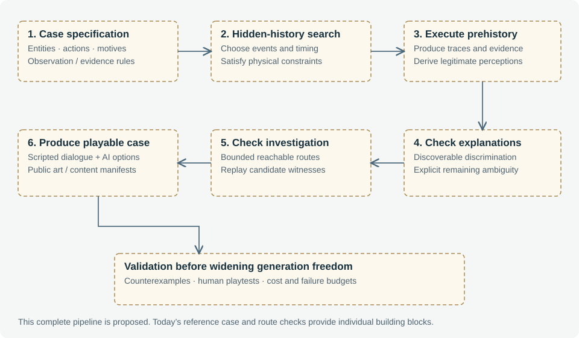
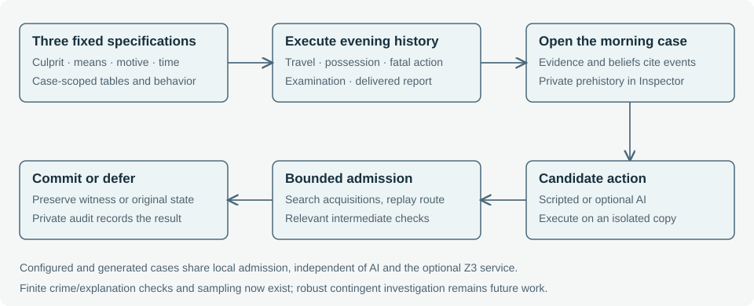

# 10. From a reference case to procedural mysteries

**Status: three authored configurations, a composable narrative-module system, a named primitive algebra with a declarative composition compiler, an affordance grammar for means, a forced-insight obligation, a seeded sampler and a prep-time LLM composer (with deterministic fallback) are implemented over the fixed cast; new-cast, relationship and map generation, richer prose, and machine-checkable difficulty remain proposed.**

## 10.1 Complete the reference case first

The Last Bell should become an adequately evaluated reference for dialogue, causality, investigation and debugging before the system generates entire mysteries. Otherwise generation multiplies unclear mechanics and makes failures harder to attribute. Completion means more than an accepted accusation: alternative investigative paths, failed interactions, timing variations and explanation quality need explicit coverage.

The first three implementation steps now provide a bounded admission foundation, parameterized executable prehistory and three hand-authored same-cast configurations. These are deliberately small reference cases. Broader hybrid autonomy, automatic rule-driven re-derivation, social investigation planning and explicit recovery policies remain prerequisites for larger domains. The original case still uses authored background summaries; the new variants create inspectable evening occurrences and source their morning evidence and knowledge to those events.

## 10.2 Proposed case-production pipeline

A future case specification should define entities, locations, routes, clocks, relationships, motives, allowable actions, evidence-production rules and observation opportunities. Generation would choose a hidden history within those constraints, execute it, derive each character's initial knowledge from actual perceptions, and construct the player-facing evidence surface.

The output should include the case model, executable prehistory trace, evidence provenance, disclosure capabilities, plan permissions, bounded solution witnesses, alternative-explanation checks and an asset manifest. Every artifact should refer to stable entity and event IDs. Generated natural-language descriptions can render this structure; they should not silently become its authority.

## 10.3 Four separate obligations

**Physical consistency:** Can the crime, cover-up and subsequent routines occur given time, travel and possession constraints? An executable witness should reproduce the intended prehistory.

**Epistemic legitimacy:** Can each witness obtain the information assigned to them? False beliefs need plausible origins, such as ambiguous perception or received misinformation. A lie requires an intentional communicative policy, not an accidental contradiction in generated prose.

**Investigative distinguishability:** Does discoverable evidence discriminate the intended explanation from relevant alternatives? A unique hidden model is not enough if all distinguishing facts are inaccessible to the player. Conversely, ambiguity may be an intentional case property, but the ending should acknowledge it rather than demand certainty unsupported by evidence.

**Reachability and playability:** Can a player acquire and connect adequate evidence within the modeled action space, and does the path remain practical under selected variations? Solver existence must be followed by engine replay and ultimately human playtesting.

## 10.4 The third use case: the final argument

The original case rejects accusations through its authored rubric. Configured/generated cases now test finite competing explanations from acquired evidence. A broader final-case interface should expose the player's premises, their sources and uncertainties, the conclusions claimed, and relevant alternative explanations. It should not secretly use the known culprit as a premise in the player's proof.

The current finite layer tests alternative assignments and produces bounded explanations. A broader multi-logic layer could extend the supported domain. A Lean certificate might later provide independently checked derivations for an explicitly formalized argument. It would certify the derivation from assumptions, not the authenticity of a witness statement or the faithfulness of its language-to-logic translation. Lean is therefore optional rather than a prerequisite for a better accusation system.

## 10.5 Staged generation and exit criteria

| Stage | New freedom | Evidence required before broadening |
| --- | --- | --- |
| G0: reference case | Finish authored mechanics and interactions | Repeatable case paths and clearly explained failures |
| G1: authored variation — implemented slice | Three same-cast culprit/method/motive/time configurations | Executed prehistory and replayed solutions; richer narrative playtests remain |
| G2: controlled sampling — implemented slice | Seeded sampling of validated same-cast specifications, composed from narrative modules | Now enforced: physical, epistemic, reachability and distinguishability obligations plus per-module invariants, over the fixed cast. Implemented additionally: typed crime/evidence rules and finite alternative-explanation checks with optional Z3 certification. Remaining: broader domains, richer prose and human playtests |
| G3: generative authoring — implemented slice | New case structures within a declared domain; a prep-time LLM composer that proposes over the validated palette, plus an affordance grammar for open object/means | Now implemented: compile→validateCase→structured-feedback repair with a deterministic fallback, per-seed cache, and forced-insight for load-bearing twists. Remaining: new casts/maps, richer prose, and machine-checkable difficulty grading |
| G4: richer playable world | Spatial actions and larger social networks | Perception semantics, performance budgets and recovery coverage |

These are development gates, not delivery dates. At every stage the deterministic mode remains a playable and testable path. Procedural cases must include sufficient authored or generated-and-validated scripted dialogue to remain usable when runtime AI is disabled.

## 10.6 Visual and operational budgets

Before enabling automatic image production, implement persistent asset caching, reusable approved imagery, deduplicated requests, per-case budgets, bounded retries and usage accounting. Key assets by public appearance, style version and output specification. Prefer existing approved assets or text fallbacks when budgets are exhausted. Reloading a case must not cause regeneration.

Similar discipline applies to reasoning: bound model deliberation, solver requests and recovery attempts; expose unresolved outcomes; retain enough provenance to investigate failures. The aim is a game whose costs and correctness boundaries remain understandable as its expressive range increases.

## 10.7 The implemented configuration pipeline

A specification supplies culprit, weapon, motive, injury and crime minute. A case factory renders consistent evidence and scripted accounts, then the kernel executes evening journeys, possession changes, a guarded fatal action, medical examination and a report delivered at a real meeting. Evidence acquisition records causal parents from that executed history; initial beliefs cite personal observations or received testimony. These source links establish the recorded origins within the authored model, not a complete theory of physical evidence or perception.

Travel and taking use shared typed plan checks, which the tests also submit to actual Z3. The fatal event and document production currently use direct engine preconditions. Calling the complete prehistory “SMT-proved” would overstate the implementation. The next formalization should represent those additional actions and evidence-production rules explicitly before expanding the specification domain.

The browser selects a configuration and keeps its ID in the save. Scripted play, views and optional character context all bind to that case. The original mystery remains selectable for compatibility and its richer correction/concealment threads. Portraits and location imagery are reused; alternate artifact imagery uses text fallback. No runtime AI or image requests are required.

The next generation gate is controlled seeded sampling of validated specifications. It must reject inconsistent histories, test discoverable discrimination among alternative suspects/methods/motives, replay an acquisition witness and package sufficient scripted content. Merely choosing a different culprit field would not satisfy these obligations.

## 10.8 Composable narrative modules and validated sampling

**Status: implemented over the fixed cast; new-cast composition and richer prose proposed.**

A case is now assembled as a **base scaffold plus composed narrative modules** ("bricks"), each a reusable unit of detective fiction conforming to one contract (`dist/modules/contract.mjs`): `bind` resolves the brick's role slots or sits out; `content` additively contributes clues, objects and proof-route entries; `prehistory` emits sourced events, beliefs and capabilities through the kernel; `capabilities` supplies NPC plan permissions; `decide`/`onInteract` drive and react to behavior; `dialogue` contributes topic responses; and `invariant` is a brick-local coherence check. `activeModules(spec)` composes them (honoring a `requires` order and passing sibling `peers` so bricks can interweave). Four bricks exist today — misdirection, correction, secret-affair and concealment — and adding a trope is one module file plus a registry line.

The **case-general validator** executes the prehistory, checks the shared physical IR, verifies typed initial belief and evidence support, replays every declared solution route, tests the acquired bundle against competing culprit/method/motive explanations, and checks module invariants. It rejects ambiguity rather than relying on the old clue checklist.

`sampleCases(seed, n)` varies culprit, weapon, motive, time, misdirection target and investigative structure. It returns candidates that pass these bounded checks. Generated IDs encode those components and reconstruct the same case on reload. Earlier full-grid results concerned the smaller parameter-only domain; they are not exhaustive coverage of the expanded structural domain.

## 10.9 Investigative structures

The `trace` structure preserves the physical comparison and independent-alibi investigation. `cleanup` adds a real post-strike wiping action, discarded residue, and a laboratory-plus-entrance-watch route that bypasses the damaged-object and alibi chain. `clockwork` requires either a calibrated timed watch or an independently timed record, paired with different motive-document routes. Bell's entrance watch is a physically executed appointment, not remote knowledge of the killing.

Each declared route is separately searched and replayed. Multiple routes can share premises; the original physical/carbon-copy pair intentionally shares most clues. The new branches provide different acquisition and inference work, but still use the same cast, map, fatal-action family and trusted-document assumptions. Broader story synthesis, uncertain forensic reliability, social acquisition and contingent recovery remain research work.

## 10.10 The primitive algebra and the composition compiler

The forensic checks were refactored into a named, versioned **primitive algebra** (`dist/primitives.mjs`,
`PRIMITIVE_ALGEBRA_VERSION`): a typed entity ontology and a small set of `CONSTRAINT` primitives
(`within`, `is`, `isNot`, `elsewhere`, `soleAt`, `soleAtOffset`) over the finite IR. Every claim
predicate (`death_time`, `location`, `crime_method`, `trace_match`, `exclusive_opportunity`,
`manner_evidence`, …) is now a thin composition of those primitives. This is the human-authored kernel:
compositions may combine primitives without limit but may not redefine them, because an oracle cannot be
produced by the thing it validates.

On top of the kernel, a **declarative composition compiler** (`dist/composition.mjs`) turns a
composition — pure data: clues, typed claims, proof-route membership, method options, and a prehistory
occurrence-DAG (with links to existing occurrence types or intra-composition ids), plus an *optional,
non-authoritative* dialogue passthrough — into the same brick hooks a hand-authored module provides.
Adequacy was demonstrated by re-expressing two live bricks (`manner-of-death`, `poisoning`) as
compositions with the whole suite still green. This is the data format the LLM composer targets: every
fact lives in the validated fields, and prose can never change a fact.

## 10.11 An affordance grammar: means as an open object catalog

The "means" axis was generalized from a fixed enum to a finite **affordance grammar** so that new murder
objects are mostly data. `dist/primitives.mjs` declares a small vocabulary of affordances —
`harm(kind)`, `transfer`, `times`, `gates`, `marks`, `conceals`, `vanishes`, `fakes` — and each reduces
to a validated kernel predicate (for example `harm`/`transfer`/`marks → trace_match`, `times →
death_time`, `gates → exclusive_opportunity`, `conceals → manner_evidence`). `dist/objects.mjs` is the
*surface*: an object is a name, a narrative injury, and a bundle of affordances, validated fail-closed
against the grammar at load. `dist/mechanism.mjs` compiles an affordance-typed composition, first
checking that each affordance-tagged clue leaves exactly the predicate its affordance is allowed to
leave, then reusing the composition compiler.

This is the seam that lets creativity expand at the object/narrative layer while correctness stays
bounded in a finite, decidable kernel. Three genuinely new objects were added this way, each roughly one
data entry plus a small mechanism: an **icicle** (a blunt weapon that *vanishes* — no weapon is found,
so a casting-mould/meltwater trace pins the method), a **silk scarf** (an everyday object as an
asphyxiant ligature, pinned by matching fibres), and a **rigged chandelier** (a *set-and-leave* fall
where the culprit sabotages the fixing and is gone before it drops — the sabotage timing, not the death,
fixes the crime window). The crime-history narration is now harm-kind-aware, so the method's act is
visible in the timeline ("rigs the chandelier to fall", "administers a fatal dose") rather than a generic
strike. `crimeModel`'s method dimension is generic (the three base weapons plus the spec's own object),
so new objects join the sampler and the LLM palette automatically.

## 10.12 Forced insight: making a twist load-bearing

Solvability is table stakes; depth needs a machine-checkable property. The `forcedInsight` obligation
(`checkForcedInsight` in `dist/casegen.mjs`) certifies that each clue a brick declares via `forces` is
*load-bearing*: it replays the winning route and re-grades the bundle with that clue removed, and rejects
the case if the true accusation still holds. Manner-of-death declares the coroner finding forced; poison
declares the toxicology finding forced (its delayed death is real — the medical exam carries no time pin,
and toxicology fixes the administration window on the examination occurrence); the icicle declares its
meltwater trace forced. A manner×method coherence guardrail (in the manner brick's invariant) additionally
rejects logically contradictory combinations — staging a fall (chandelier) as a fall, or a poisoning as a
self-inflicted wound — following the split "LLM common sense for plausibility, symbolic layer for
logical/causal/temporal coherence".

## 10.13 The LLM composer

`dist/llm-composer.mjs` closes the loop the pipeline was built for. The model **composes** a mystery by
choosing values over the fixed, validated **palette** (never inventing characters, methods, motives, or
predicates): `composeCase` parses the proposal, compiles it with `buildSpec`, validates it with the same
`validateCase` oracle the whole engine trusts, and on rejection feeds **structured feedback** (the failing
obligations by name, or the `buildSpec` error) back for a bounded repair loop. If the model cannot produce
a valid case within its attempts, it falls back to the deterministic sampler, which is always certified;
results are cached per seed. Model prose (title/synopsis) is threaded through as non-authoritative flavor.
A live proxy adapter (`llmFromProxy`, contract in `server/llm_proxy.py`) carries the request; the app
exposes it as "Generate with AI", and the composer was verified live producing validated, divergent cases.
Variety is driven by a per-generation temperature and a seed-derived "lead" so repeated generations spread
across the palette rather than collapsing to one favourite combination.

This realizes the trust boundary end to end: **the LLM proposes with world knowledge inside the palette
guardrails; the symbolic engine enforces logical, causal and temporal coherence and hands back structured
feedback when something does not hold.** What remains is richer *machine-checkable difficulty* — obligations
that grade inference depth and red-herring pressure so generated cases are scored on being genuinely
hard to solve, not merely valid — and generation of new casts, maps and settings.

## 10.14 A general mystery kernel and recursive refinement

**Status: implemented for "who" questions in a fixed setting; other question types, adventure verbs and new settings
proposed.**

The composable-brick pipeline above is tied to one village's forensic enumeration. The mystery kernel replaces it with
a model that does not depend on the setting. A case is a set of typed records: entities, events (with time span,
place, participants and the attitude that caused them), attitudes (an agent's stance toward a proposition), rules,
signs (observable effects of events: traces, documents, testimony, behaviour) and a question with candidate answers.
The language model never states what a sign rules out; it picks one claim per sign, an instance of a fixed predicate
(`wasAt`, `nobodyAt`, `had`, `onlyHad`, `related`, `hasTrait`, `crimeBetween`, `crimeFact`, `culpritHad`,
`culpritRelated`, `culpritTrait`; see [chapter 12](worked-example.md#12-3-the-representation) and the
claims specification, `docs/claims.md`), and the kernel computes truth values in the history, eliminations from what the
player knows, access depth and reading depth.

Certification is plain code: interval and travel checks for the true history; a justification check that every
intentional event and every false sign has its cause; monotone reachability for access; set filtering for uniqueness;
per-candidate **thread depths** (when each innocent is cleared and when the truth finally survives); a twist check
(the surface survivors exclude the truth); and checks that false signs have deeper true defeaters, that every access
and reading edge states an in-world reason, and that spoken times match the timeline.

Generation is a loop. Code seeds a trivial case, then repeatedly schedules the shallowest thread and asks the model
for a refinement that deepens it (or, early on, a twist, positive motive and means evidence, and a red herring). Each
candidate patch must certify, obey the refinement laws, make progress, and pass an independent plausibility review;
several candidates run in parallel and the best passing one is kept. Across the experiment runs this reliably reached
solve depth 5–9 with every target met. In the fixed Bellweather setting, published cases are compiled into the
existing runtime by a bridge, so they play with the original characters, including model-driven dialogue.

## 10.15 Generation in the game and play-time content

**Status: implemented for the Bellweather setting.**

`server/generator_server.py` (loopback, port 8789, exact Origin/Host and an `X-Living-Mystery: generator-v1` header)
runs one generation at a time and exposes incremental progress events that the browser polls. On completion the case is
published: questions for each account, every character's evening account, the doctor's examination, spoken lines for
showing each clue and reactions for the characters involved, then JavaScript certification before it is listed.

Two pieces of content bear on fairness, and both are what everyone in the village knows: *public signs*, which the
player holds from the start and which appear in the notebook as common knowledge. One gives when the crime happened
(the crime window), which the player needs in order to use alibis. The others give each suspect's physical traits that
a clue tests (also shown in each person's description), because a trait clue can rule someone out only if the player
knows who has the trait. Reasoning uses nothing else the player is not told. Other generated lines are claimless
and do not enter certification; they are checked mechanically (no times or numbers that are not in the source, length
limits, no second-person address in third-person lines).

A generated case takes roughly 10 to 20 minutes, dominated by sequential model calls for the first draft and each layer.

## 10.16 Motive, means and opportunity; the premise deck; the Z3 oracle

**Pillars.** Both kernels compute, besides opportunity (the survivors), the culprit's **means** (a true claim that the culprit had
the item or trait, or a culprit claim the culprit satisfies) and **motive** (a true relation claim connecting the culprit and the victim: a secret about the culprit alone is not a reason to kill
this person), each with the depth at
which it is first understood. Publishing requires both to be reachable; innocents may have motives of their own, so no
single pillar names the culprit. The generator deepens a pillar found more than two levels before the answer.

**Premise deck.** Code draws the victim (anyone but the constable and the doctor), the culprit and three other
suspects, one of nine methods fitted to the scene, one of eight motives and one of six case shapes, preferring what was
used least recently. The seed is rejected unless it honours the draw; the case's answer (method, motive) is known by
construction. The first draft is deliberately simple: variety comes from the premise, depth from about sixteen layers.

**Z3 oracle.** `server/case_oracle.py` encodes the true history (one place at a time, walking times, the crime inside
its window) and, for any evidence set, each candidate's alibi and attribute constraints, independently of the kernels.
Unsat cores name the evidence that rules each suspect out; a satisfying minute is an alternative story. Publishing
requires Python, JavaScript and Z3 to agree.

**Publish-time content.** Everyday knowledge, moods, loose-end accounts and concessions carry no claims and are checked
not to mention hidden clues or lies; every written line is then reviewed against the true history and faulty lines are
dropped. Independent steps run in parallel.

## 10.17 The history is the only source of facts

Facts enter a case only through generation, where they are certified. Every account must be **backed** by the true
history: an event its speaker took part in, being at that place at that time, a claim about themselves, or something
they knew (a 'knows' attitude cited as the account's reason). Both kernels compute this (`account_backing`); the publish
gate rejects any unbacked account. Generation must write the body's **discovery** and the **examination** as typed
events, the examination by the setting's examiner after the discovery and before the investigation begins. Roles and the
day's boundaries come from the setting, so no code names a person. Publishing adds only wording: questions, evening
summaries of a person's own events, the examination's notes and account (worded from the examination event), lines and
reactions. In play, a clue that comes from someone's own doing draws their own account; replies for anyone else are worked
out from the history (elsewhere at that time) or a single neutral line, never a guess. The fact-checker sees all of a
character's accounts, so a reply contradicting any of them is rejected.

Three further rules follow from the same principle. **Nobody is in a case without a history:** people the history never
mentions are removed at publish, and every suspect must have an evening. **No account, no facts:** when the history gives
a person nothing on a question, the game says one neutral line and the model may only decline or ask; implied facts
("on my rounds", "I gave my word") are rejected, and a character asks what the detective means at most once in a row.
**The answer is what the evidence supports:** method and motive categories overlap (a quarrel over a secret about to
come out), so at publish a reviewer reads only the evidence the player can find and lists every category it fairly
supports; the accusation accepts any of them, and a wrong reason names the motive evidence to read again.

**What people can say.** Each person's evening is written from their evening events and their morning from their own
morning events (never evidence, always the discovery and examination); a reviewer that knows who everyone is marks each
honest or a cover story and gives its reason, and an innocent's account that is not honest is rewritten with it. Seed
drafts that fail are repaired, not redrafted, with every rule broken so far listed. End to end, fresh cases certify,
solve, rate at their target difficulty, and about 96% of replies to a standard question set come from the model
(`tools/e2e_dialogue.mjs`).

**Questions that ask the same thing.** An account's own question ("Where were you last night, Mr Pike?") can reword a
standard one ("What is your account of last night?"). A model groups such questions per person at publish and marks
the account `same_as` the question it rewords; in play that question brings the account out, so the menu never offers
both. Rewriting the questions instead was tried: the rewrites asked about something else or gave the account away.

**What people saw.** Every pair of people at one place at one time in the true history is a candidate sighting; each is
added and the case certified again, and it is kept only if the solve is unchanged (depth, every thread, the surface
reading, the false accounts). So a witness can say whom they saw without ever shortcutting the puzzle.
