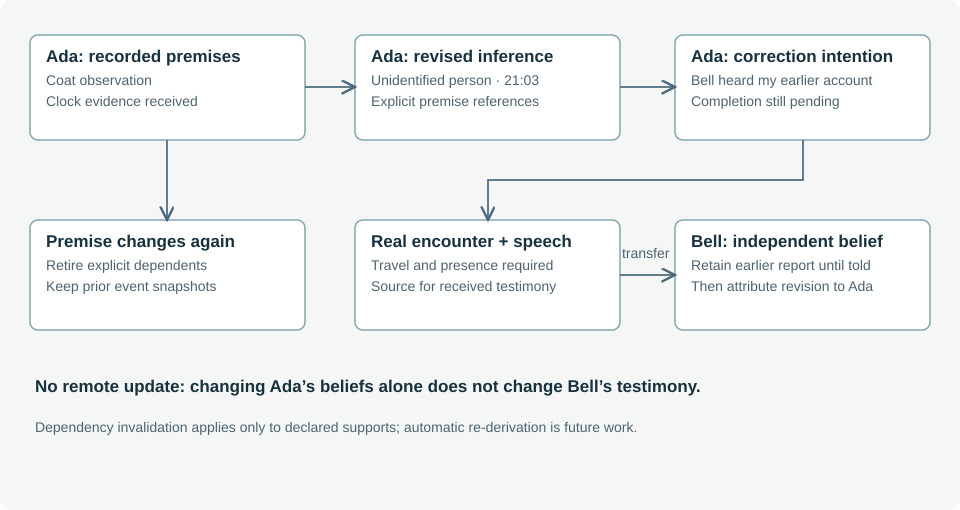

# 3. World state, assertions and knowledge

**Status: provenance, dependency invalidation and registered configured-case support rules are implemented; general inference discovery remains proposed.**

## 3.1 Separate representational roles

| Representation | Authority | Example |
| --- | --- | --- |
| World state | Current engine state | The folio's holder is Silas. |
| Event | Recorded occurrence and changes | Ada spoke to Bell at a particular minute. |
| Assertion | Attributed contents of a statement | Ada said she identified Rowan. |
| Belief | A character's retained proposition | Bell provisionally accepts Ada's account. |
| Memory | Retained reference to an experienced event | Ada remembers showing or telling someone something. |
| Player hypothesis | Player-authored interpretation | This clue supports a suspect's opportunity. |
| Intention or plan | Proposed future behavior | Ada intends to correct Bell in person. |

These roles may refer to the same subject without having the same truth conditions. Committing a speech event establishes that the speech happened; it does not establish that its assertion is true. A belief's inspector-only `truth` annotation is a case-author label, not a theorem derived by Z3 and not information supplied to the character model.

## 3.2 Time of occurrence and time of acquisition

Case-night assertions can describe 21:03 while being acquired by the detective the following morning. Structured claims carry selected predicates and time intervals; events carry acquisition or execution time. Mixing these axes would make later testimony appear to be a later crime-night occurrence. The inspector and reasoning tools must preserve the distinction.

The claim projection compares a bounded set of assertions. Overlapping intervals that place the same person at different locations can conflict; disjoint death windows can conflict; a planned appointment does not establish presence. These comparisons do not constitute full temporal theorem proving. They also do not estimate whether two agreeing witnesses are independent.

## 3.3 Perception is an event, not access to the world object

A stationary character receives movement observations for arrivals or departures at its location. The observation contains the subject, phase and observed location. It does not grant the subject's private purpose, destination or entire route. Transit is not a common room in which all travelling characters can overhear each other.

Object transfers similarly create local observation events. Case callbacks can attach narrative consequences: a witness who sees Silas take the folio can later report that action. A survey observes visible surroundings at execution time, not at the time an AI proposed travelling there. It does not automatically read all evidence or award the detective a notebook clue.

## 3.4 Belief revision and dependency invalidation

`dist/knowledge.mjs` records belief text, confidence, source type, source event, acquisition time and optional speaker metadata. An inferred belief can additionally declare premise keys and the corresponding source IDs. This is explicit provenance, not a natural-language dependency extractor.



Replacing an active belief records the previous belief in the new event. Retiring one records its reason and removes it only from the active list. A changed premise recursively retires dependent inferences for reconsideration. Cyclic support is rejected. Repeating an identical supported update is idempotent; hearing the same statement again as a genuinely new event remains a distinct experience.

```text
revise(actor, premise):
    identify active inferences that explicitly depend on premise
    retire those inferences and their transitive dependents
    append the replacement belief, retaining its source and predecessor
    leave historical prefixes and other actors' independent beliefs intact
```

Retirement is not automatic re-derivation. A case rule may produce a new conclusion from revised premises; the current runtime does not generally recompute every retired inference or ask a solver to resolve it. Nor do all existing authored beliefs declare dependencies. Coverage is therefore an explicit authoring responsibility.

## 3.5 Testimony and completed intentions

Generic communication creates attributed testimony in the recipient, with unknown case truth rather than copying the speaker's certainty into objective truth. Updating the speaker later does not remotely update the recipient. A queued message is blocked if its source belief changes before delivery, requiring a fresh plan.

A completed intention has a similar lifecycle. Ada's pending correction is retired after the actual speech to Bell; a completed belief cites that speech. Generic queued plans retain a cursor, cause and status and record completion or blockage. A promise is not marked complete simply because the words were accepted by a critic.

Confidence values are currently authored or bounded policy values, not calibrated Bayesian probabilities. Showing “99%” should not be read as an empirical accuracy guarantee. Future work should examine whether qualitative confidence displays communicate the model more faithfully.

## 3.6 Typed support and live admission

New configured prehistories declare exact supported accounts and typed premises. Source validation checks what an occurrence establishes and whether the character personally observed it or received the testimony. A valid but unrelated event ID fails. Evidence claims have separate predicate-specific production checks.

Configured live belief updates now pass registered support rules before state changes. The rules cover presented evidence, attributed reports, transfers, local surveys and current case inferences. Unknown support rules fail closed; the registry is the extension point for new knowledge operations. Player testimony remains explicitly uncertain. In particular, Ada's clock correction adjusts timing without claiming to establish identity or whereabouts. Original-case knowledge policy remains separate, and semantic review of LLM wording remains the dialogue critic's responsibility.
