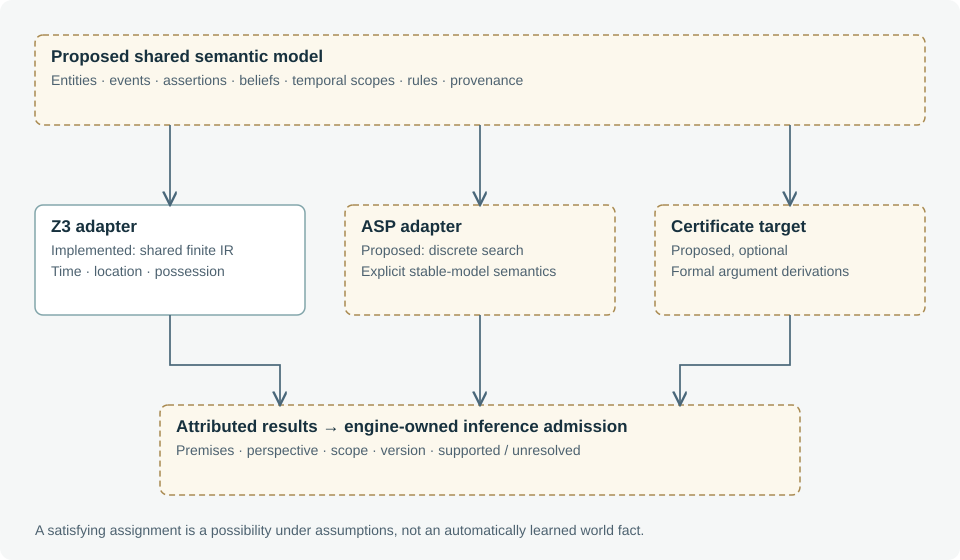

# 5. Shared symbolic representation and solver adapters

**Status: a finite plan IR and Z3 adapter are implemented; the general multi-logic knowledge model is proposed.**

## 5.1 Why introduce a solver?

Many immediate conditions are simplest as ordinary code: whether a recipient is present, an object exists, or a player has discovered a clue. A solver becomes useful when conditions interact across several events: travel time, ordered transfers, mutually incompatible locations, possession at successive steps and bounded completion. The intended benefit is an inspectable set of explicit constraints, not replacing every conditional with a solver call.

The current Z3 integration checks concrete candidate plans. The local compiler also produces a concrete witness and evaluates its own constraints. Z3 independently solves the translated formula, but both paths depend on the same compiler's interpretation. Agreement is useful validation of the encoding and adapter; it is not independent evidence that omitted physical rules were modeled correctly. [Z3 project paper](https://www.microsoft.com/en-us/research/publication/z3-an-efficient-smt-solver/).

## 5.2 The implemented fragment

`dist/actions.mjs` defines a closed vocabulary. `dist/symbolic.mjs` translates steps into integer location/holder codes, time variables and Boolean conditions. The expression language includes equality, ordering, addition, conjunction, disjunction and negation. A query carries a version, kind, perspective, variable domains, named constraints, source IDs, assumptions and horizon.

| Action | Required condition | Physical effect |
| --- | --- | --- |
| move | Reachable destination; declared duration matches route | New location after travel |
| observe | Presence at location; a specified object is visible | No holder/location change; executor records experience |
| communicate | Source belief exists; immediate recipient is present | No physical change; executor records speech/testimony |
| take | Actor and object are at the source | Holder becomes actor |
| give | Actor possesses object; recipient is present when executed | Holder becomes recipient |
| conceal / store | Actor possesses object at a declared container's location | Holder becomes container |

For a movement step from u to v, the intended time relation is `tᵢ₊₁ = tᵢ + distance(u,v)`. For taking object o, the preconditions include `location(actor,i) = u` and `holder(o,i) = u`, with effect `holder(o,i+1) = actor`. Unchanged entities receive frame constraints. The plan's final time must lie within its horizon.

Plans contain one to eight steps with a default 120-minute horizon. The Python adapter bounds queries to 128 variables and 256 constraints and bounds expression depth and node count. Z3 receives a 1,500 ms timeout and resource limit of 200,000. Client turn verification permits at most 12 queries within a 10-second deadline. These bounds are implementation limits, not measured optimal operating points.

## 5.3 Conditional meetings and unsupported semantics

Immediate checks use live participant state instead of trusting a proposed `recipientPresent` value. A communication or gift after earlier steps can be admitted with an explicit assumption that the recipient will be present later. The current compiler does not predict that person's complete future schedule as part of the query. Execution rechecks the meeting; conditional satisfiability does not guarantee delivery.

Unsupported verbs, fields or container references are rejected or deferred rather than silently interpreted. The current fragment does not represent general doors, line of sight, capacity, force, combat, simultaneous resource contention or arbitrary social obligations. Adding a verb requires compiler, executor and counterexample tests, not just a new model prompt.

## 5.4 Result semantics

| Result | Justified interpretation | Unjustified interpretation |
| --- | --- | --- |
| sat | At least one assignment satisfies the encoded constraints | This happened, is true, or will inevitably happen |
| unsat | The encoded constraints are jointly inconsistent | The entire story is impossible in every richer model |
| unknown / unavailable | The requested check did not establish an answer | Permission to apply the candidate anyway |
| route_found | An engine-replayed candidate reached the authored goal | All player choices or future policies remain safe |

Results include solver/adapter versions and a query digest. The client matches returned queries to the submitted queries and checks returned witnesses against variable bounds and all constraints. Unsatisfiable cores expose named conflicting constraints with source information; a core is not necessarily the unique or smallest explanation.

## 5.5 A future common semantic layer

The intended shared representation is broader than today's action-query IR. It should include typed entities, physical events, attributed assertions, epistemic contexts, temporal scopes, rules and query obligations. Adapters declare which fragments they support. Each inferred result should carry its premises, perspective, time scope and derivation status before engine-owned knowledge admission.

Z3 is the starting point for bounded temporal and physical constraints. ASP is a possible later target for discrete action or case generation where stable-model and default semantics are useful; clingo provides an open-source ASP system. Lean is a possible optional target for independently checkable argument certificates. Neither adapter exists in this prototype, and neither should be added solely to maximize the number of supported logics. [Potassco clingo](https://potassco.org/clingo/).

Translations must preserve declared semantics rather than treating different logics as interchangeable syntax. In particular, an absence of knowledge is not automatically evidence of falsity. The first useful cross-adapter experiment would compare a deliberately shared finite fragment and record disagreements or unsupported operations, before attempting unrestricted inference feedback.
